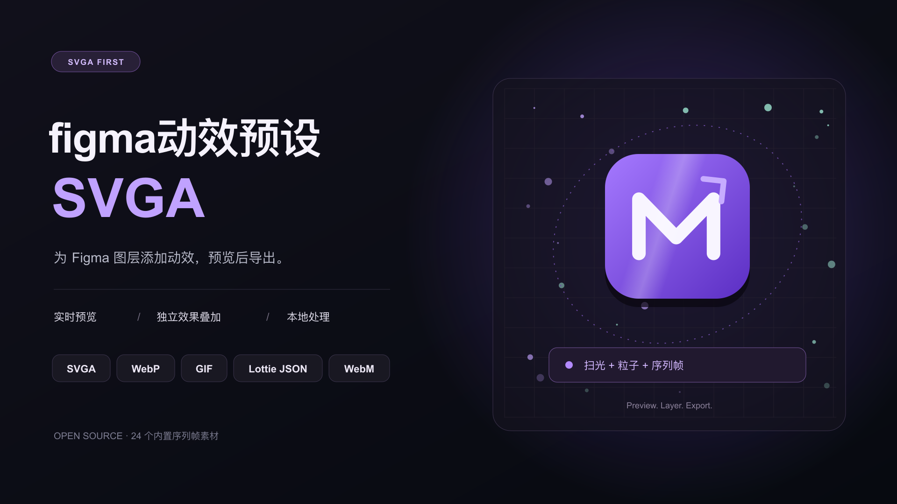

# figma动效预设-SVGA



Figma 动效插件，以 SVGA 为默认格式，支持实时预览、独立效果叠加及多格式导出。预设序列帧从 GitHub 按需加载，动效合成与导出在本地完成。

## 安装与开发

直接使用：在 [GitHub Releases](https://github.com/klinghui80-web/figma-motion-presets-svga/releases) 下载发布 ZIP，解压后在 Figma 桌面版的 Plugins → Development → Import plugin from manifest 中选择 `manifest.json`。已提交构建好的 `ui.html`，运行插件无需安装开发依赖。[Figma Community](https://www.figma.com/community/plugin/1699346735533425751) 已于 2026-11-03 提交审核，公开安装需等待 Figma 批准。

需要完全离线使用时，可下载 [v1.0.0](https://github.com/klinghui80-web/figma-motion-presets-svga/releases/tag/v1.0.0)；该版本内嵌全部素材，因体积限制仅通过 GitHub 提供。

问题反馈和功能建议请提交到 [GitHub Issues](https://github.com/klinghui80-web/figma-motion-presets-svga/issues)。

参与开发需要 Node.js 22+、npm 和 Python 3.10+：

```sh
npm ci
npm run build
npm test
npm run release:package
```

发布包输出到 `dist/`。更多信息见 [参与贡献](CONTRIBUTING.md)、[隐私说明](PRIVACY.md)、[第三方声明](THIRD_PARTY_NOTICES.md) 和 [发布流程](docs/RELEASING.md)。项目代码按 [MIT](LICENSE) 发布；第三方库与素材各自保留原许可证。


在 Figma 中选择图层，先实时预览并调整参数，再导出 SVGA 2.0 动画文件。横向工作台中，左侧管理图层，中间固定预览，右侧选择素材与调整参数；导出操作固定在右下角。

## 动效类别

- 基础动效：淡入、上浮淡入、弹入、旋转入场、上下弹跳。
- 扫光：统一使用原“其他 → 流动高光”的渲染效果，高光带沿对象透明轮廓掠过。保留颜色、高光强度、扫动速度和高光宽度；不再区分硬切/柔和，也不再提供旧扫光的形状与羽化等控件。
- 发光：外发光、呼吸发光。
- 光照：自定义光源可在预览区点选光源位置，以多束独立渐隐的体积光线照亮图像，并调方向、展开角、长度、强度、数量、粗细、柔化、近端/远端颜色、流动、摆幅和速度；动态可单独开关。图层光照依据透明轮廓向外发射光线与外发光；另有轮廓流光。
- 粒子：飘落、发射、火焰升腾、波浪游动、漩涡聚合、闪烁星星。每个子效果单独保存样式、颜色和参数：飘落默认白色雪花（核心半径 12px），发射/波浪/漩涡默认白色圆点（16/14/16px），火焰为橙黄色柔光火星（18px），星星为六边形发光光斑（40px）。大小表示原始素材中的核心半径，光晕额外扩展；可恢复单个子效果的默认值。另支持星形、闪光、光圈和自定义图片，以及起点、方向、扩散角、速度、随机变化、整体不透明度、透明度随机、生命周期、衰减、闪烁、羽化和拖尾等参数。颗粒以独立的峰值透明度贯穿渐入、变亮和淡出的过程，避免长时间维持实心高亮。粒子默认循环时长为 4 秒，返回其他效果时恢复原时长。
- 序列帧：24 个真实透明动效素材，含火焰、光环、烟雾、爆发、传送和气泡，可搜索和按分类筛选。支持独立播放/导出、叠加所选图层、PNG 序列导入和 Figma 多图层读取，以及循环、往返、倒序、单次、素材帧率、速度、透明度、延后、循环间隔、大小、位置与混合方式。
- 置换：水波、环形涟漪、热浪、液态流动、呼吸波动、斜纹扫动、横线扰动、竖线波动、环绕扭曲、碎裂错位、故障扰动、波纹扭曲。
- 其他：故障风、火焰、闪亮、闪烁、扫描线。“流动高光”已合并到扫光，不再重复列出。

## 使用

1. 在 Figma 中以开发插件方式导入本目录下的 `manifest.json`。
2. 左侧“动效模式”滑块默认使用单选：点击新预设会替换当前效果，便于逐个挑选；重复点击当前预设保留已调参数。切到动效叠加模式后，每次点选都添加独立效果层，同一个预设也能重复添加；已有图层继续保留。此规则适用于所有类别和序列帧导入。
3. 左侧点击效果层独立调参，使用眼睛图标显隐、卡片右上角的 × 删除。原图为共享底图，叠加模式下效果按添加顺序从下到上合成；右下角导出当前所有可见图层。切回单选时只保留当前选中效果，其余效果移除；选中原图时则保留最上方可见效果。序列帧按各自素材帧率以 1× 播放。
4. 右下角“导出格式”默认 SVGA，也可选择 WebP、GIF、Lottie JSON 或 WebM，再点击导出按钮。五种格式采样同一套最终合成画面，帧率和输出分辨率共用；切换格式不会修改任何动效或参数。

## 额外导出格式

| 格式 | 画面与透明度 | 使用说明 |
| --- | --- | --- |
| SVGA（默认） | 原有 PNG 栅格帧和完整透明度 | 保留原来的 SVGA 2.0 导出逻辑。 |
| 动态 WebP | 无损颜色与 8 位透明度 | 保留粒子、柔光和叠加画面；推荐用于需要保真动图的场景。 |
| GIF | 每帧最多 256 色，只有全透明/全不透明 | 可选黑底、白底或透明；默认黑底以保留柔光观感。透明 GIF 会丢失半透明边缘。背景只用于 GIF 编码，不改变预览或其他导出。 |
| Lottie JSON | 内嵌逐帧 PNG，保留完整透明度 | 使用标准图片层，保留渲染结果而不重建为矢量动效；文件可能较大，不提供可编辑的矢量关键帧。目标播放器必须支持内嵌图片。 |
| WebM | 高质量 VP8 视频及独立透明通道 | 按固定时间戳离线逐帧编码，不录屏、不按实时播放采样。视频压缩有损，透明显示取决于播放器；运行环境需提供 WebCodecs / VP8 编码器。 |

WebP、GIF 的循环素材默认无限循环；仅含单次序列帧的场景导出为单次播放。Lottie / WebM 的循环由使用它们的播放器控制。GIF 以 10 毫秒、WebP / WebM 容器以毫秒表示时间；24 FPS 等非整数帧间隔使用累计时间取整，避免逐帧舍入造成持续时间漂移。

附加编码库（gifenc、jSquash/libwebp）随插件离线内嵌，不会上传你的素材。来源、版本、许可证与文件哈希见 `vendor/SOURCES.json` 和同目录许可证。运行 `python3 scripts/build-sequence-library.py` 会同时更新缩略图、固定素材地址、场景和导出编码模块。为符合 Figma Community 的 15 MB 上限，24 个原始图集从 `assets/sequences/hosting.json` 指定的固定 GitHub 提交按需下载，SHA-256 与源码素材核对后再解码；同一会话内复用已加载图集。首次使用某个预设序列帧需要网络，自定义帧和动效合成不依赖此下载。

运行 `node tests/exports.test.cjs` 验证附加格式编码、Lottie PNG 字节和可见帧、分数帧率时间轴、GIF 背景处理、WebM alpha 平面、冻结场景采样与离线内嵌。输出目录默认为 `/tmp/motion-exports-test`，可通过 `MOTION_EXPORT_OUTPUT` 指定。

## 输出说明

- 输出 SVGA 2.0（zlib 压缩的 Protobuf 数据和逐帧 PNG 图像）。
- 动画以栅格帧输出，保留透明背景；不会生成可编辑的 Figma Motion 关键帧。
- 帧率、持续时间、分辨率和帧数会影响文件大小。
- 扫光继续使用所选对象的 PNG alpha 轮廓遮罩。自定义序列帧以最大宽高建立输出区域，各帧居中对齐，输出缩放只应用一次。
- 发光由外轮廓光晕、底部氛围光、向外光线、星光/粒子和动态闪烁组成，提供独立参数组。
- 发光导出时自动扩展画布边界，为轮廓外的光晕与光线留出空间。
- 序列帧素材来自 OpenGameArt 的 CC0 资源；作者、原文件与播放设置见 [素材来源](assets/sequences/SOURCES.md)。缩略图内置，完整预设图集按需联网加载，原始文件、尺寸、透明度和帧率均保留。
- 自定义光源在预览中点选发光位置；播放时每束光独立呼吸、摆动并带有流动高光。图层光照沿透明轮廓生成外向光线。光照/粒子/置换素材为本插件重建的 Canvas 动效，不是原插件提供的专有素材，需在预览中按项目调整。

## 粒子验证

运行 `node tests/particles.test.cjs` 检查六种运动的确定性、循环衔接、方向、聚合、速度为零及像素大小。预览与 SVGA 逐帧渲染共用同一套粒子状态。

粒子效果为独立重建，支持多个粒子层与其他类别叠加，每层单独保存外观、大小、不透明度和随机种子。当前未实现相邻粒子作用场和手绘牵引路径。

## 序列帧使用与验证

- 点击“序列帧”进入素材库，再点素材卡片即可正常播放；不会继续沿用之前效果的时钟。
- 素材帧率 × 播放速度决定逐帧播放时间。例如 64 帧、30 FPS、1× 的一轮为 2.133 秒；2× 为 1.067 秒。导出 FPS 改变采样密度，不改变素材的时间轴；帧数取整时，导出时长误差小于一帧。
- “自定义帧”可导入 2–240 张 PNG，或读取 2–240 个 Figma 所选图层。两种方式都按名称中的数字自然排序（frame_2 在 frame_10 之前）；默认 30 FPS，可自行调整。
- 单选模式下点选素材会替换当前效果；叠加模式下每次点选都会添加新序列帧层，可同时存在多个素材。各层独立保存帧率、播放方式、透明度、位置与大小；叠加时异步加载按发起顺序保留图层。切换模式或替换素材后，已移除图层的异步返回会被忽略。原图继续关联，取消选择或多选自定义帧也不会丢失底图。
- “往返”不会重复首尾帧；循环间隔期间隐藏动效；延后时间作为每轮开始前的空白时间。“单次”在预览中停留在末帧，SVGA 文件是否再次播放由使用它的播放器决定。
- 所有效果共用一个从下到上的效果栈：基础动效、扫光、发光、光照、粒子、置换、其他效果和多个序列帧都能叠加。位移、缩放、透明度、置换等修改器影响下方已合成的内容；序列帧可选择跟随下方变换，也可在预览中直接拖动位置。当前未提供色调调整和手绘区域删减。

运行 `node tests/sequence.test.cjs` 验证播放时序、各播放模式、速度、自然排序、图集裁剪、透明度、叠加尺寸和离线资产完整性。修改 `src/sequence.js` 或素材后，运行 `python3 scripts/build-sequence-library.py` 更新插件 UI。粒子回归验证命令保持为 `node tests/particles.test.cjs`。全部检查可通过 `npm test` 运行。

## 合成与布局验证

运行 `node tests/composition.test.cjs` 做像素级合成验证，覆盖所有动效作为独立层参与渲染、六层同时贡献像素、同种预设参数隔离、共享底图 alpha、帧率与时长、延后时间、半分辨率置换采样、合成顺序/显隐/删除、单选替换与叠加添加、切回单选保留当前层、多个序列帧乱序加载及过期返回和导出快照。该检查使用 `@napi-rs/canvas`，优先读取 Node 本地模块或 Codex 的依赖运行时；也可用 `MOTION_CANVAS_MODULE` 指定模块路径。

修改 `src/scene.js` 后同样运行 `python3 scripts/build-sequence-library.py`。所有类别共用同一套场景渲染与绝对时间时钟；右侧参数独立滚动，中央预览和右下角导出保持可见。

同一合成周期取可见图层周期的最大值，各层按各自周期播放。只有全部可见效果都为“单次”的序列帧时，预览才会在工程末尾停住。逐帧 PNG 和导出快照包含全部可见效果，调整参数或切换图层不会修改正在导出的快照。
